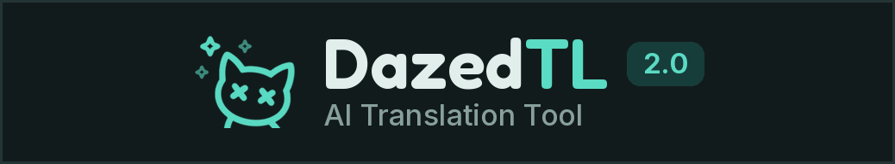
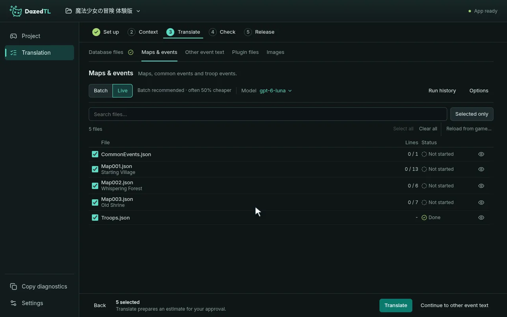
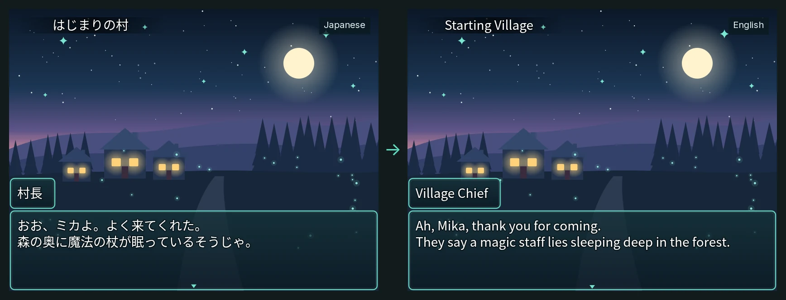
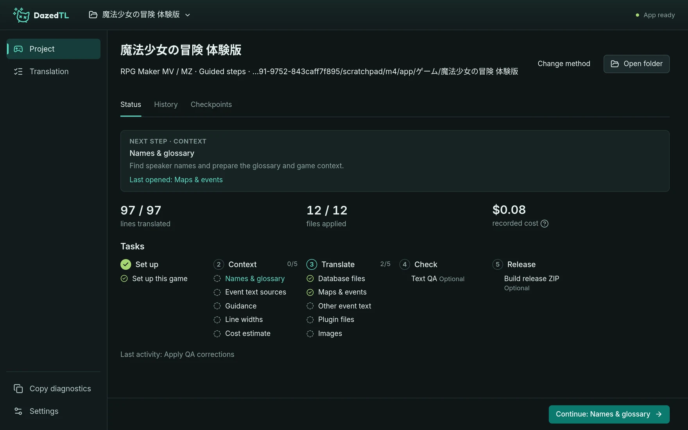
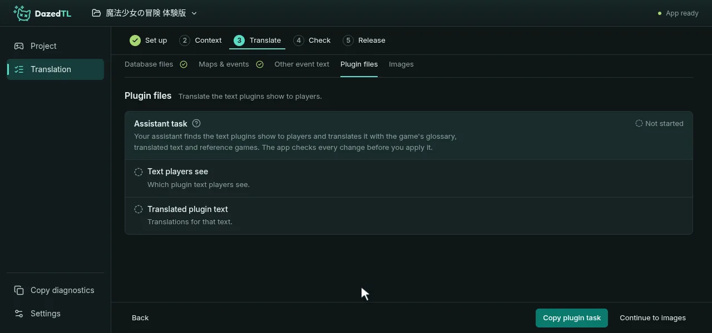
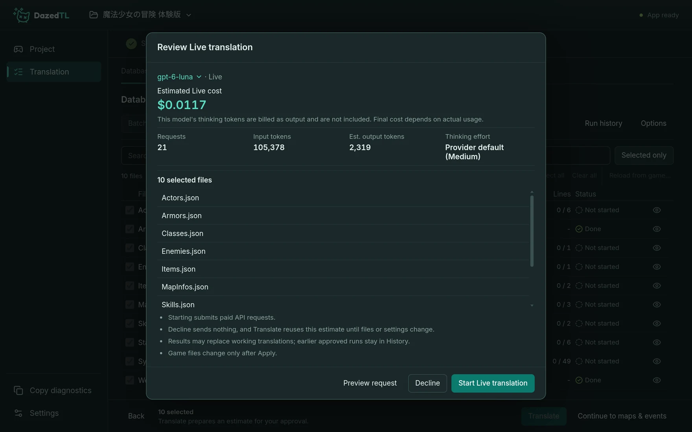
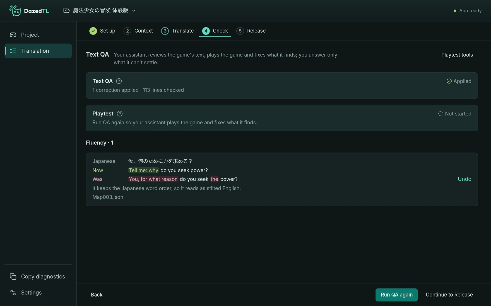
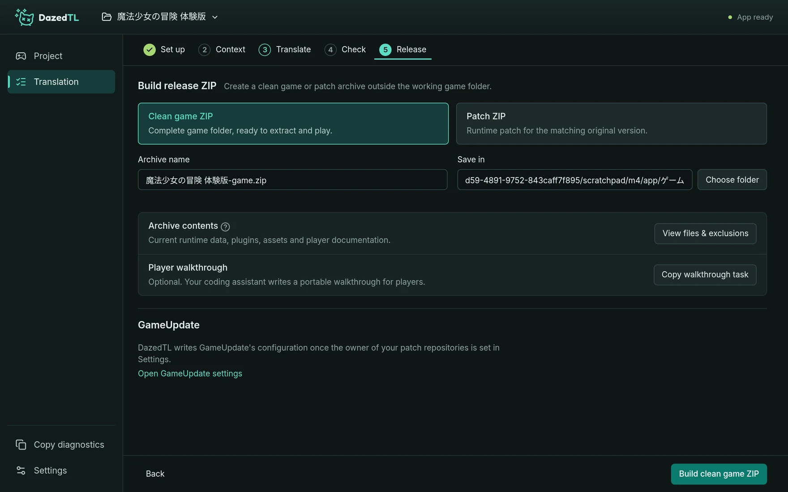

  

  <b>Translate games with AI. No programming needed.</b> 
  DazedTL walks you through each step, and an AI coding assistant does the parts that need investigating.

  
  
  
  
  

  <a href="#install"><b>Install</b></a> ·
  <a href="docs/user-guide.md"><b>User guide</b></a> ·
  <a href="CHANGELOG.md"><b>What's new</b></a> ·
  <a href="https://discord.gg/StsRWHPupu"><b>Discord</b></a>

  

## What it does

DazedTL translates a game's text with your AI provider and writes it back into the game's own files, so the game itself plays in your language.

  

### Two ways to translate

- **Guided steps**, for RPG Maker MV, MZ and VX Ace games: DazedTL leads you through five stages.
  Your API key translates the dialogue and database text, and your assistant handles names, plugins, images and other text it has to look into.
- **Assistant-led**, for any game: your assistant does the whole translation from one starting prompt, either by itself or through your API key.

  

### Hand the tricky parts to your assistant

Names, plugins, images and other text that needs looking into become tasks DazedTL copies for your assistant.
Paste one in and keep DazedTL open: the results show up by themselves, and DazedTL checks every change before you apply it.

  

### See the cost before you pay

With a frontier model such as Claude Opus 5.5, an average-sized game costs about $20–30 to translate; a small one can cost under $10, and a very large one $50 or more.
Anything that uses your API key shows an estimate first, and nothing is charged until you approve it.
Batch translation is often half the price of Live, if you can wait.

  

### Have it checked

Text QA has your assistant review the translation, and play MV and MZ games, fixing what it finds.
You answer only what it can't settle, and every correction can be undone.

  

### Share it

**Release** builds a clean game ZIP, or a patch ZIP with only the changed files.
Every change DazedTL makes to the game is a checkpoint you can undo, and a new version of the game merges into your translation.

  

## What you need

- An AI coding assistant, such as Claude Code or Codex.
  DazedTL gives you tasks to paste into it.
- An API key from OpenAI, Anthropic, Google Gemini, Mistral, Kimi, DeepSeek or OpenRouter, or a local model, for translating the game text.

## Install

1. Download the ZIP from [GitHub](https://github.com/dazedanon/DazedTL/archive/refs/heads/main.zip), [GitGud](https://gitgud.io/DazedAnon/dazedtl/-/archive/main/dazedtl-main.zip) or [git.dazedtl.dev](https://git.dazedtl.dev/dazed/DazedTL/archive/main.zip).
2. Unzip it somewhere easy to find, such as `C:\DazedTL`.
   Avoid OneDrive folders.
3. Open the folder and double-click **START.bat** on Windows, or run **START.sh** on Linux.
   If Windows warns that the publisher could not be verified, click **Run**; if it says it protected your PC, click **More info**, then **Run anyway**.

There is nothing else to install.
The first start downloads what DazedTL needs, about 300 MB, and takes a few minutes.
After that, open DazedTL from the Start menu or desktop shortcut, or your Linux application menu.

## Get started

1. Open **Settings**, choose your AI provider and paste its API key.
2. Open **Project**, click **Open a game**, pick the game's folder and choose how to translate it.
3. Follow the steps, and paste each task DazedTL copies into your assistant.

The [user guide](docs/user-guide.md) explains every step.

## Updates

DazedTL updates itself.
When a new version is ready, **Settings** shows a dot: open its **Updates** tab to see what's new and click **Restart to update**.
Your projects, settings and API keys are kept.
The [changelog](CHANGELOG.md) lists what changed in every version.

## Good to know

- DazedTL translates between languages written in different scripts, such as Japanese to English or English to Japanese; pairs in the same script, such as English to Spanish, aren't supported yet.
- WOLF RPG games don't have guided steps yet; translate them Assistant-led.
- On Ubuntu 24.04 and newer, the first start shows a one-time command to run in a terminal before DazedTL can open.
- macOS has a **START.command** launcher, but it hasn't been tested yet.
- If something goes wrong, click **Copy diagnostics** in the sidebar and include it when you report the problem on [Discord](#community).

## Community

- Ask questions, share your translations and report problems on the [AI Translations Discord](https://discord.gg/StsRWHPupu).
- DazedTL is free. If it helps you, you can support it with any amount on [Gumroad](https://dazedanon.gumroad.com/l/dazedanon).

Working on DazedTL itself? See the [development guide](docs/development.md).
